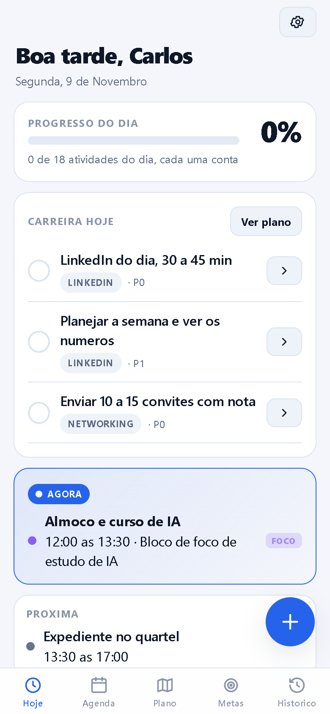

# Execução Diária, a personal execution system

An offline-first PWA I built and use every day to run my own routine: it turns time into execution, execution into results and results into progress. It is not a to-do list. It models a day as a schedule with focus blocks, tracks the tasks and the career plan tied to each day, and scores how much of the day I actually executed. No backend, no login, every bit of data stays on the device.

**Live app:** https://execucao-diaria-seven.vercel.app

<p align="center">
  
</p>

## Why I built it

My days run across several fronts and nothing was tying them together. I did not want another task app, I wanted a system that answers one question honestly at the end of the day: did I execute what I set out to do. So I designed it, shipped it solo, and I open it every morning.

## What it does

- **Routine engine.** A day is a sequence of time blocks (work, focus, meals, training). The app always knows what is happening now and what comes next.
- **Daily score.** Every item of the day counts once toward a single percentage, so the day has an honest number instead of a vague feeling.
- **Career plan by date.** Posts, courses and milestones are scheduled and surface on the day they are due, without polluting the routine.
- **Tasks, goals and history.** Plan the week, track goals, and look back at past days.
- **Installable and offline.** Add to the iPhone home screen and it runs full screen with no network.

## Engineering notes

- **Pure, testable domain logic.** The scheduling and scoring rules are pure functions (given a date and the plan, return what is due and the score), separated from React and from storage, and covered by unit tests with `fake-indexeddb`.
- **Date and frequency scheduling.** Items can be one-off, daily (weekdays), weekly or monthly; a single function resolves what a given date owes, which keeps the "today" view and the progress math consistent.
- **Offline-first PWA.** Service worker and manifest via `vite-plugin-pwa`; installable, works with no connection.
- **Local-only data.** IndexedDB through Dexie.js, with JSON export and import for backup. Nothing leaves the device.

## Tech stack

React, TypeScript, Vite, Dexie.js (IndexedDB), `vite-plugin-pwa`, Vitest.

## Run locally

```bash
npm install
npm run dev     # http://localhost:5173
npm test        # unit tests
npm run build   # production build in dist/
```

Design docs (requirements, architecture, UX, data model, business rules, testing, roadmap) are in [`docs/`](docs/).

## Note

The interface is in Portuguese because I built this for my own daily use. The code, structure and this README are in English. A short Portuguese guide is in [README.pt.md](README.pt.md).

## License

MIT, see [LICENSE](LICENSE).
